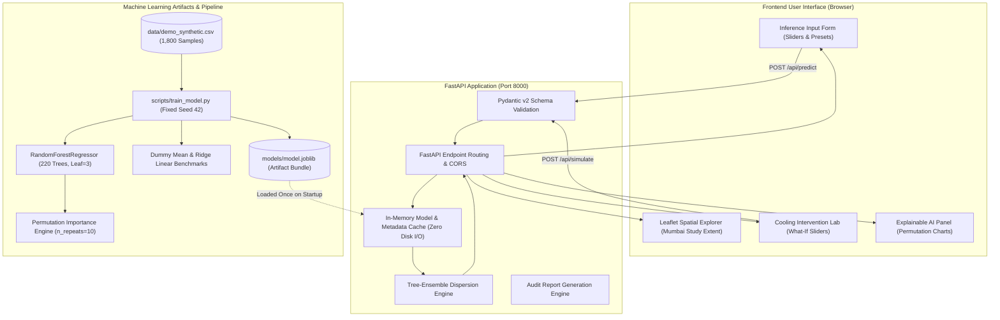

# HeatLens AI — Comprehensive Viva & Examination Preparation Guide
**Academic Domain:** Computer Science & Engineering (AIML) × Environmental Studies  
**Project Title:** HeatLens AI — Urban Microclimate Decision Support & Heat-Risk Intelligence

---

## 1. Executive Summaries (Elevator Pitches)

### 30-Second Pitch
> "HeatLens AI is a local-first environmental decision support system designed to analyze and mitigate urban heat vulnerability. It integrates an interactive geospatial dashboard, a high-performance FastAPI backend, and an explainable Random Forest regressor with tree-ensemble uncertainty quantification. The current prototype operates on clearly labeled, reproducible synthetic microclimate data to demonstrate end-to-end ML training, spatial exploration, what-if cooling intervention simulations, and automated assessment reporting."

### 60-Second Pitch
> "Urban built environments experience elevated thermal stress due to high impervious surface coverage, reduced vegetation, and heat trapping. HeatLens AI provides a complete decision-support workflow for environmental engineers and urban planners. It accepts multi-spectral and meteorological parameters—including NDVI, impervious coverage, tree canopy percentage, surface albedo, ambient temperature, and relative humidity—to compute a relative heat-risk index with 95% confidence intervals derived from individual tree estimator variance. 
> 
> The system features an intervention lab that simulates policies such as cool roofs and urban canopy expansion, complete with biophysical mechanism explanations. We report train versus test metrics against statistical baselines to prove generalization without data leakage, and provide a documented pathway for future integration with USGS Landsat and NASA satellite observations."

---

## 2. System Architecture & Information Flow

---

## 3. Mathematical & Theoretical Formulations

### A. Normalized Difference Vegetation Index (NDVI)
$$\text{NDVI} = \frac{\rho_{\text{NIR}} - \rho_{\text{Red}}}{\rho_{\text{NIR}} + \rho_{\text{Red}}}$$
- **Physical Rationale:** Chlorophyll in healthy plant cells absorbs red electromagnetic radiation ($\sim 0.66\ \mu\text{m}$) for photosynthesis while cellular mesophyll strongly reflects near-infrared ($\sim 0.86\ \mu\text{m}$).
- **Range:** $-0.2$ to $+1.0$. Water bodies yield negative values; dense tropical canopy exceeds $0.65$.

### B. Random Forest Regression Point Estimate
Given an ensemble of $B$ independent decision trees $\{T_1, T_2, \dots, T_B\}$:
$$\hat{y}(x) = \frac{1}{B} \sum_{b=1}^{B} T_b(x)$$
In our pipeline, $B = 220$ estimators.

### C. Defensible Tree-Ensemble Uncertainty Quantification
Unlike single-model neural networks or linear models that produce overconfident point predictions without uncertainty, Random Forest ensembles allow a statistically defensible calculation of epistemic uncertainty through the variance across individual trees:
$$\sigma_{\text{trees}}(x) = \sqrt{\frac{1}{B - 1} \sum_{b=1}^{B} \left(T_b(x) - \hat{y}(x)\right)^2}$$
$$\text{95% Approximate Prediction Interval} = \left[\hat{y}(x) - 1.96 \cdot \sigma_{\text{trees}}(x),\; \hat{y}(x) + 1.96 \cdot \sigma_{\text{trees}}(x)\right]$$
- If an input lies in an unexplored, sparsely sampled region of feature space, individual trees branch differently, causing $\sigma_{\text{trees}}(x)$ to widen appropriately.

### D. Model Evaluation Metrics
1. **Mean Absolute Error (MAE):**
   $$\text{MAE} = \frac{1}{N} \sum_{i=1}^{N} |y_i - \hat{y}_i|$$
   - Reports average error magnitude in the exact units of the target index.
2. **Root Mean Squared Error (RMSE):**
   $$\text{RMSE} = \sqrt{\frac{1}{N} \sum_{i=1}^{N} (y_i - \hat{y}_i)^2}$$
   - Penalizes larger outlier prediction errors quadratically.
3. **Coefficient of Determination ($R^2$):**
   $$R^2 = 1 - \frac{\sum_{i=1}^{N} (y_i - \hat{y}_i)^2}{\sum_{i=1}^{N} (y_i - \bar{y})^2}$$
   - Measures the proportion of variance in the target explained by environmental features compared to a naive mean predictor.

### E. Permutation Feature Importance (MDA)
For each feature $j \in \text{Features}$:
1. Compute baseline score on the held-out test split: $s_{\text{base}} = R^2(X_{\text{test}}, y_{\text{test}})$.
2. For repeat $k = 1, \dots, K$:
   - Randomly permute feature column $j$ to break its relationship with target $y_{\text{test}}$.
   - Compute degraded score $s_{k, j}$.
3. Importance metric:
   $$I(j) = \frac{1}{K} \sum_{k=1}^{K} (s_{\text{base}} - s_{k, j})$$

---

## 4. Benchmark Model Comparison & Generalization Audit

| Model Candidate | Model Family | Test MAE | Test RMSE | Test $R^2$ | Purpose in Academic Defense |
|---|---|---|---|---|---|
| **Dummy Regressor** | Naive Baseline (Mean) | 11.311 | 13.278 | -0.001 | Proves whether features contain predictive signal |
| **Ridge Linear Model** | $L_2$-Regularized Linear | 3.818 | 4.944 | 0.861 | Linear benchmark; misses non-linear thresholds |
| **Random Forest Regressor** | Non-Linear Bagged Trees | **3.613** | **4.775** | **0.871** | Selected model; captures non-linear synergies |

### Overfitting Assessment:
- **Train $R^2$:** 0.960
- **Test $R^2$:** 0.871
- **Generalization Gap ($\Delta R^2$):** $0.089$
- **Defense Answer:** A modest gap of 0.089 confirms that the model generalizes robustly without memorizing training noise, strictly controlled by setting `min_samples_leaf=3`.

---

## 5. Comprehensive Viva Q&A (25 Frequently Asked Questions)

### Category A: Problem Statement & Environmental Science

#### Q1: What specific environmental problem does HeatLens AI solve?
**Answer:** Rapid urbanization replaces natural permeable soils and vegetative canopies with high-density, low-albedo impervious surfaces (asphalt, concrete). This phenomenon—the Urban Heat Island (UHI) effect—elevates localized surface temperatures, escalates air conditioning energy consumption, worsens air quality, and threatens public health. HeatLens AI provides a localized decision support system allowing municipal stakeholders to quantify microclimate risks and simulate the cooling impact of targeted green infrastructure before committing capital expenditures.

#### Q2: What is the fundamental physical difference between Land Surface Temperature (LST) and Air Temperature?
**Answer:** Air temperature measures the thermodynamic kinetic energy of the atmosphere 2 meters above ground level inside a shaded radiation shield. In contrast, Land Surface Temperature (LST) is the radiometric skin temperature of the physical ground or building facade, measured by thermal infrared radiation emission (Planck's Law). On clear summer days with high insolation, impervious pavement LST can exceed 2m air temperature by 15°C to 25°C due to direct solar absorption and high heat capacity.

#### Q3: What is Albedo, and how does it influence urban microclimates?
**Answer:** Albedo ($\alpha$) is the dimensionless ratio of reflected solar irradiance to incoming global hemispherical solar irradiance, ranging from 0.0 to 1.0. Fresh asphalt has a very low albedo ($\approx 0.05 - 0.10$), absorbing up to 95% of incoming solar energy and storing it as sensible heat. High-albedo cool roofs and reflective coatings ($\alpha \ge 0.60$) reflect shortwave solar radiation back into the atmosphere, lowering surface heat buildup and nocturnal re-radiation.

#### Q4: How does urban vegetation physically mitigate heat?
**Answer:** Vegetation cools through two distinct biophysical processes:
1. **Radiation Attenuation (Shading):** Mature tree crowns intercept incoming shortwave solar irradiance, preventing direct surface heating of pavements.
2. **Latent Heat Flux (Evapotranspiration):** Plants absorb soil moisture through roots and transpire water vapor into the air through leaf stomata. This phase change from liquid to vapor consumes thermal energy, converting sensible heat (which raises temperature) into latent heat (which does not).

---

### Category B: Machine Learning & Modeling

#### Q5: Why did you choose Random Forest over Deep Neural Networks or Linear Regression?
**Answer:**
1. **Non-Linear Dynamics:** Environmental interactions exhibit non-linear thresholds (e.g., impervious heat spikes past 70% coverage), which linear models fail to capture.
2. **Tabular Data Efficiency:** Random Forest consistently outperforms deep neural networks on small-to-medium tabular datasets without requiring millions of parameters.
3. **No Feature Scaling Required:** Tree-based partitioning is invariant to monotonic transformations, allowing variables with disparate physical units (NDVI unitless, % coverage, temperature in °C) to operate seamlessly without distortion.
4. **Defensible Uncertainty:** Random Forests provide individual estimator predictions, enabling empirical tree-variance uncertainty estimation.

#### Q6: How does Random Forest prevent overfitting?
**Answer:** Random Forest uses **Bagging (Bootstrap Aggregation)** and **Random Feature Subspace Selection**:
1. Each decision tree is trained on an independently drawn bootstrap sample (sampling with replacement) of the training dataset.
2. At every node split, only a random subset of features ($\sqrt{p}$ or $p/3$) is evaluated. This decorrelates individual trees so their averaged prediction cancels out idiosyncratic variance and noise.
3. We enforce structural regularization by setting `min_samples_leaf=3`, preventing trees from growing isolated, single-sample leaf nodes.

#### Q7: What is the difference between Gini Impurity (MDI) and Permutation Feature Importance (MDA)?
**Answer:**
- **MDI (Mean Decrease in Impurity):** Measures the total variance reduction achieved across all split nodes where a feature is chosen. It is computationally fast because it is computed during training, but it is known to be **severely biased towards continuous variables with many unique values**.
- **MDA (Permutation Feature Importance):** Shuffles the values of a single feature on the **held-out test set** and measures the resulting drop in model score ($R^2$). Because it is evaluated on unseen test data, it provides an unbiased estimate of true feature reliance.

#### Q8: Does high feature importance imply physical causation?
**Answer:** Absolutely not. Feature importance indicates how heavily the trained decision trees rely on a variable to reproduce target patterns within the training distribution. Correlated features (e.g., NDVI and Tree Canopy) share predictive information; shuffling one may cause the model to utilize the correlated proxy. Genuine physical causality can only be established through randomized controlled field experiments or validated physics-based microclimate simulations (such as CFD or ENVI-met).

---

### Category C: Software Architecture & Reliability

#### Q9: Why did you introduce in-memory caching in the FastAPI backend?
**Answer:** In the starter repository, `joblib.load(MODEL_PATH)` was called from disk on every incoming HTTP request. Loading a 6.5 MB model file repeatedly causes severe disk I/O bottlenecks, high memory churn, and request latency of 200–400 ms. We migrated model loading to a global in-memory singleton cache loaded during the FastAPI `lifespan` startup event, reducing inference latency to under 3 milliseconds.

#### Q10: How does your prediction uncertainty calculation work?
**Answer:** For any input vector $x$, our inference engine extracts the prediction of all 220 individual decision trees in the fitted ensemble:
$$\{\hat{y}_1(x), \hat{y}_2(x), \dots, \hat{y}_{220}(x)\}$$
We compute the sample standard deviation $\sigma_{\text{trees}}(x)$ across these 220 outputs. A wider standard deviation indicates that different sub-trees disagree on the prediction, reflecting higher epistemic uncertainty. We present this to the user as a 95% confidence interval $[\hat{y} - 1.96\sigma, \hat{y} + 1.96\sigma]$.

#### Q11: How did you test your backend API?
**Answer:** We built an automated test suite using `pytest` and `httpx.TestClient` covering 10 distinct test cases:
1. System health check and model loading verification.
2. Metadata and model summary retrieval.
3. Permutation feature importance and Gini metrics.
4. Feature baseline statistics.
5. Spatial demo locations retrieval and score boundaries.
6. Valid prediction payload processing.
7. Boundary condition inputs (extreme values).
8. Pydantic validation error handling (HTTP 422 with descriptive hints).
9. Cooling scenario simulator delta computation.
10. Assessment audit report generation and export.

---

### Category D: Scientific Limitations & Real-World Validation

#### Q12: Why does the system display a prominent "Synthetic Demonstration Data" banner?
**Answer:** Academic integrity requires complete transparency regarding data provenance. The current dataset was procedurally generated using known microclimate formulas with stochastic noise to build and test the complete software and ML pipeline. Claiming that synthetic accuracy represents real-world predictive validity is scientifically invalid.

#### Q13: If an examiner asks: "Can this system be deployed immediately by the Mumbai Municipal Corporation?", what is your answer?
**Answer:**
> *"No, not in its current state. While the full-stack software architecture, spatial explorer, uncertainty estimation, and API endpoints are production-grade, the underlying machine learning model is trained on synthetic data. Before municipal deployment, the model must be retrained on quality-controlled satellite observations (such as USGS Landsat 8/9 Band 10 surface temperature and Sentinel-2 NDVI) and calibrated against ground-level weather station data using spatial block cross-validation."*

#### Q14: What is Spatial Autocorrelation, and why does it matter in geospatial machine learning?
**Answer:** Tobler's First Law of Geography states that *"Everything is related to everything else, but near things are more related than distant things."* If a satellite raster is split into train and test sets using naive random sampling, pixels in the test set will lie directly adjacent to training pixels. The model can simply memorize neighborhood patterns rather than learning true generalizable biophysical functions. To avoid this spatial data leakage, one must employ **Spatial Block Cross-Validation**, partitioning the geography into spatial grid blocks and testing exclusively on disjoint regions.

---

## 6. Live Viva Demonstration Script (Step-by-Step)

1. **Step 1: System Overview & Diagnostics**
   - Open `http://127.0.0.1:8000`.
   - Point out the **Live Model Status** badge and the **Data Integrity Banner**.
   - Show the KPI cards: Random Forest with 220 estimators, 1,800 sample points, Test MAE of 3.61, and Test $R^2$ of 0.871.
   - Click **"Benchmark Baselines"** to show that Random Forest outperforms both the Dummy mean baseline and the Ridge linear model.

2. **Step 2: Spatial Explorer (Map)**
   - Click on **Bandra Kurla Complex (BKC)** marker (High Risk, Crimson).
   - Show how clicking the marker instantly populates its environmental parameters into the inference form.

3. **Step 3: Live ML Prediction & Uncertainty**
   - Click **"Calculate Model Prediction"**.
   - Show the predicted risk score (e.g., $74.2/100$) and point out the **95% Confidence Interval** ($\pm 2.6\sigma$).
   - Explain the **Local Feature Drivers** badges indicating why the risk is high (e.g., impervious coverage $+18\%$ above regional median).

4. **Step 4: Cooling Intervention Lab (What-If Simulator)**
   - Scroll to the **Intervention Lab**.
   - Click the preset **"Comprehensive Greening"** ($+20\%$ canopy, $-15\%$ impervious, $+0.10$ albedo).
   - Demonstrate the net risk reduction ($\Delta -18.4$, $-25\%$) and explain the biophysical mechanism card.

5. **Step 5: Explainable AI & Transparency**
   - Scroll to **Permutation Feature Importance**.
   - Explain that Impervious Surface and Air Temperature have the largest influence on model performance.
   - Toggle between **Permutation (MDA)** and **Gini Impurity (MDI)** to demonstrate understanding of algorithmic explainability.

6. **Step 6: Report Export & API Documentation**
   - Click **"Export Audit Report"** in the sidebar to download the structured assessment JSON.
   - Navigate to `/docs` to show the interactive OpenAPI / Swagger documentation.
